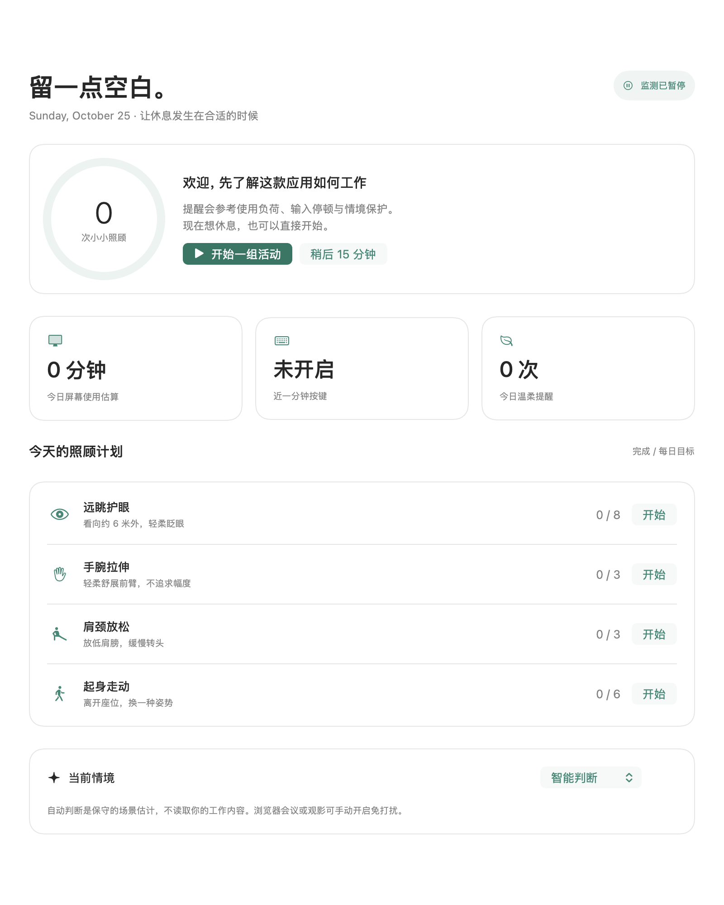

# 间歇 · Interval

为专注留空间，为身体留间歇。面向 Apple Silicon 的原生 macOS 智能休息助手。

SwiftUI · macOS 14+ · arm64 · 本地优先 · 无第三方依赖

[下载预发布 DMG / ZIP](https://github.com/geraldpeng6/interval-mac/releases/tag/v1.0.0-rc.1)



[深色预览](docs/images/today-dark.png) · 预览为原生组件离屏渲染，完整窗口与交互仍待验收。

## 能做什么

- **抓住间隙**：结合屏幕使用估算、键盘负荷和输入停顿，邀请你休息，而非定时强弹。
- **保护情境**：会议/影音应用、全屏、麦克风占用时延后；也可手动选择工作、学习、会议或观影。
- **自由组合**：远眺护眼、手腕、肩颈、起身走动及可选盆底觉察；每项可调频率、时长、每日目标及顺序。
- **跟着做**：分步计时、暂停、继续；完成引导后记录，提前结束不计未完成的活动。
- **学习提醒**：在学习模式下，用户标记的分心应用持续停留时温和提示，不读取学习内容。
- **轻量统计**：菜单栏常驻、最近七天趋势、30 天本地每日汇总、导出和清除。
- **可选云端**：用户指定的 HTTPS Chat Completions 服务仅接收聚合字段；Key 保存在 macOS 钥匙串。

## 安装

从本仓库 Releases 下载 DMG（拖动安装）或 `Interval-1.0.0-arm64.zip`。ZIP 解压后将 `Interval.app` 拖入“应用程序”并打开。初次启动可先体验活动，点击“同意并开启本地监测”才开始采样；键盘计数还需单独开启“输入监控”。不开键盘权限也能使用屏幕估算和活动引导。

当前默认构建为 **ad-hoc 签名、未公证**。从网络下载后 macOS 可能拦截；自行审阅来源后，可按系统“隐私与安全性”页面的提示允许打开。不要关闭系统安全保护。它没有经过 App Store 审核。

关闭窗口后仍在菜单栏运行。完全退出请用菜单栏“退出间歇”。登录启动由用户在偏好设置手动启用。

## 本地构建

需要 Xcode 16+ / Swift 6+ 的命令行工具。无需 Node、Python、模型下载或外部包。

```sh
./scripts/check.sh
./scripts/package.sh
ditto -x -k build/Interval-1.0.0-arm64.zip "$HOME/Applications"
open "$HOME/Applications/Interval.app"
```

也可在 Xcode 打开 `Package.swift` 编辑。打包脚本构建原生 arm64 release，验证签名和架构，再生成 ZIP、DMG 与 SHA256。默认将 Swift 临时构建目录放在系统临时目录，避免 iCloud Documents 的 Finder 扩展属性污染测试包签名。

如拥有适用的签名证书，可设置 `INTERVAL_SIGN_IDENTITY`；发布前仍需自行完成 Apple 公证及 stapling，脚本不会宣称仅签名就已公证。

## 智能判断的边界

内置的是零依赖、可解释的轻量规则评分模型，不是读取屏幕的多模态大模型。不能确知你是否真正疲劳、注视屏幕、走神或完成动作。会议应用打开不代表正在开会；同一浏览器内的视频/会议可能漏判。可用手动情境覆盖，并为应用分类。

护眼默认参考 20-20-20；起身活动参考 HSE 频繁短休。每日目标和其余剂量是可修改的产品初始值，不是人人适用的医学处方。手腕疼痛时不强行拉伸。盆底活动默认关闭，包含充分放松提示。

- [产品与决策设计](docs/DESIGN.md)
- [健康参考来源](docs/HEALTH_SOURCES.md)
- [隐私说明](docs/PRIVACY.md)
- [验证记录](docs/VALIDATION.md)

当前版本仍在预发布验证：原生窗口实测因本机锁屏待继续；完整边界见验证记录。

MIT License.
